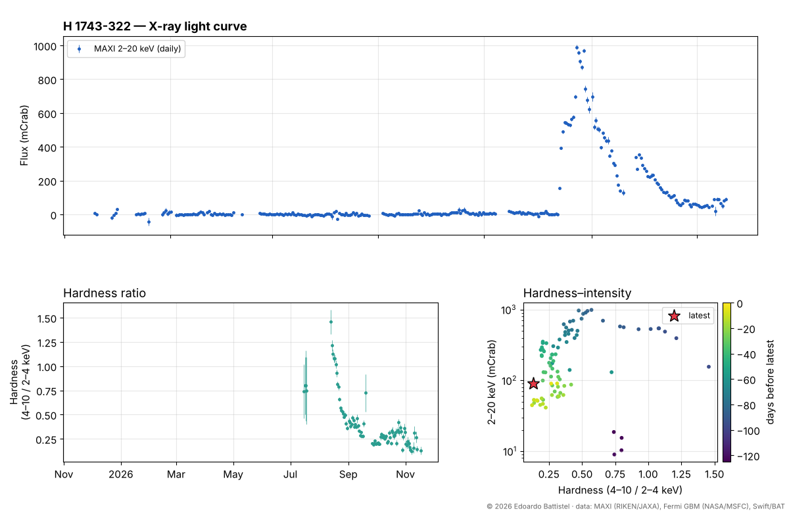
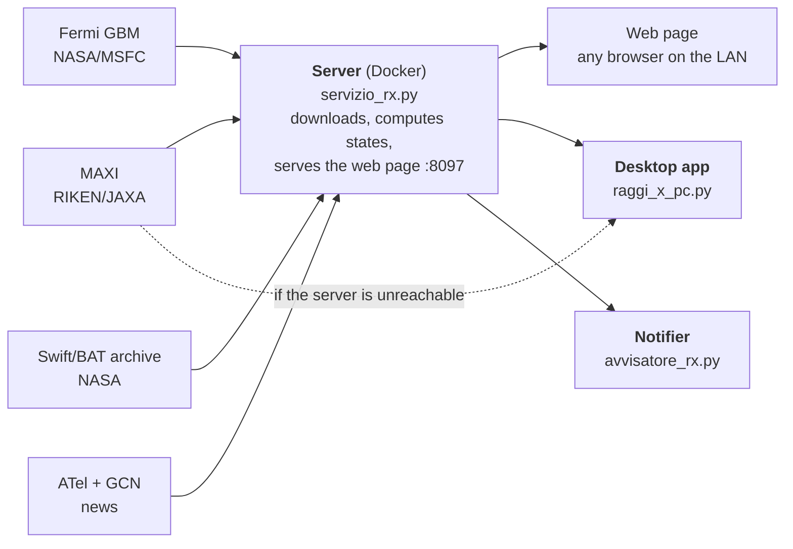
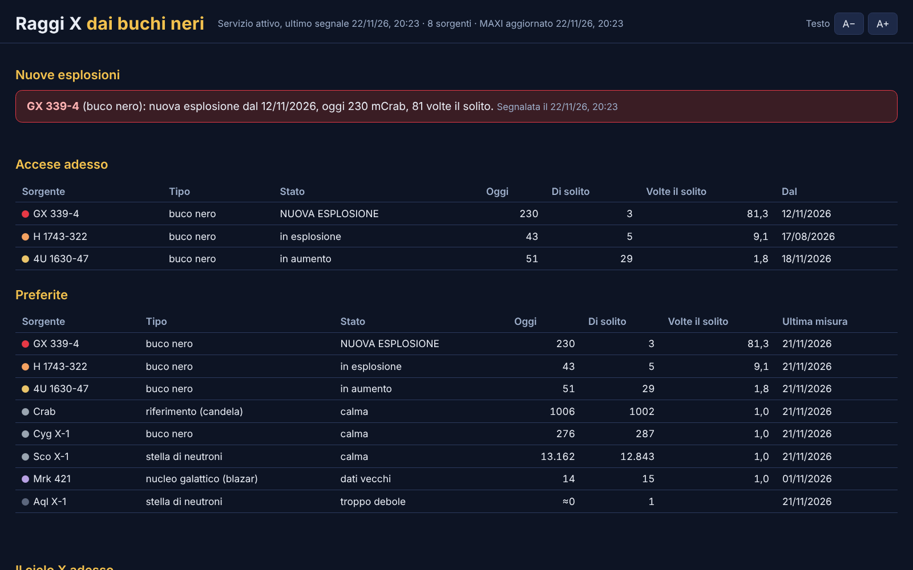
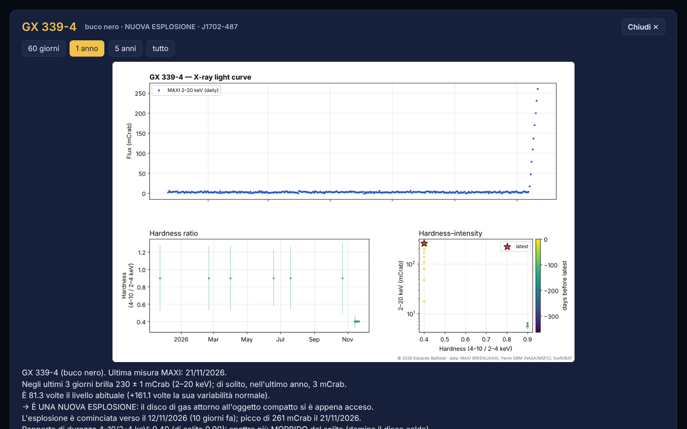

<p align="center"></p>

# X-rays from Black Holes

*An X-ray outburst monitor for black holes and neutron stars — original Italian name: «Raggi X dai buchi neri»*

**X-rays from Black Holes** (in Italian *Raggi X dai buchi neri*, the name you will see in the interface) watches the variable X-ray sky every day and tells you
when an X-ray binary, an X-ray pulsar or an active galaxy **goes into outburst**. It is built for amateurs and
students who want to follow the high-energy sky from home, with a small server (a NAS or any always-on Linux
box running Docker) and a desktop app.

* Downloads the daily light curves of **all ~457 sources monitored by [MAXI](http://maxi.riken.jp/)** (2–20 keV,
  on the International Space Station), the hard X-ray light curves of **Fermi GBM** (Earth occultation, 12–300 keV)
  and the archival **Swift/BAT** Transient Monitor history (15–50 keV, 2005 – 20 Oct 2026).
* Decides for every source whether it is **in a new outburst**, **in outburst** (with start date and peak),
  **rising**, **fading**, **at its usual level** or **too faint**, by comparing the last 3 days with the
  previous year.
* Computes the **hardness ratio** (4–10 keV / 2–4 keV) and draws the **hardness–intensity diagram**, where
  outbursting black holes trace their famous "q"-shaped track from the hard to the soft state and back.
* Reads the latest **ATel** telegrams and **GCN** circulars and links them to the sources they mention.
* Serves a web page on your local network, and a desktop **notifier** pops up when a new outburst starts.

> **Language note.** The user interface (web page, desktop window, notifications) is in **Italian**; all plots,
> axis labels and scientific output are in **English**. The code is commented in Italian. This documentation is
> in English; the original Italian guide is in [`docs/LEGGIMI.it.txt`](docs/LEGGIMI.it.txt).

<p align="center">
  
  <br><em>Real MAXI data: the 2026 outburst of the black-hole candidate H 1743-322 (start 14 Aug 2026,
  peak ≈ 950 mCrab on 24 Aug). In the hardness–intensity diagram (right) the source starts hard, brightens and
  moves to the soft state while it fades. Data: MAXI (RIKEN/JAXA/MAXI team).</em>
</p>

## How it is organised



* **`nas/`** — the server. It runs in a `python:3.12` container at the lowest priority, refreshes MAXI every
  6 hours (one request per second, only changed files are downloaded again), Fermi GBM once a day, the news every
  30 minutes, and waits and retries the *same* source if an archive does not answer.
* **`pc/`** — the desktop part for Ubuntu/GNOME: a Tk window with the list of sources and the plots, and a
  notifier. The window asks the server first; if the server is unreachable (for example when you are away from
  home) it downloads directly from the archives and computes everything itself.
* **`tools/`** — a network check that tries every archive from your network before you install anything.

<p align="center">
  
  
  <br><em>The web page and a source card, shown with the simulated data of the built-in self-test.</em>
</p>

## Quick start

Requirements: a Linux machine with Docker for the server (tested on a UGREEN NAS with UGOS Docker), and Python 3
with `numpy`, `matplotlib` and `tkinter` for the desktop part (tested on Ubuntu with Python 3.14).

```bash
git clone https://github.com/EDOKILLER/x-rays-from-black-holes.git
cd x-rays-from-black-holes

# 1. optional: check that every archive is reachable from your network
python3 tools/prova_rete_raggi_x.py

# 2. optional: try the server on your PC with 25 real sources, then open http://localhost:8097
cd nas
python3 servizio_rx.py --prova                               # offline self-test (20 checks)
python3 servizio_rx.py ~/raggi_x_test --una-volta --max 25   # one real cycle, then exit
python3 servizio_rx.py ~/raggi_x_test --solo-pagina          # serve the page on :8097
```

Then follow **[docs/installation.md](docs/installation.md)** to run the server with Docker and install the
desktop app and the notifier.

## Documentation

| | |
|---|---|
| [Installation](docs/installation.md) | Server with Docker, desktop app, notifier, updating |
| [How it works](docs/how-it-works.md) | Outburst detection, mCrab units, hardness, news matching, network behaviour |
| [Configuration](docs/configuration.md) | `rx_config.json` options, files written by the server, command-line options |
| [Data sources and acknowledgements](docs/data-sources.md) | MAXI, Fermi GBM, Swift/BAT, ATel, GCN: formats, caveats, how to credit them |
| [Changelog](CHANGELOG.md) | Versions 0.1 → 1.1 |

## Known limitations

* MAXI does not observe every source every day: gaps of 10 days happen. A source is marked "old data" only after
  14 days without measurements.
* MAXI has a wide point-spread function. **GX 354-0 (the Slow Burster) and the Rapid Burster (MXB 1730-335) are
  blended**: a sudden brightening of "GX 354-0" is almost always the Rapid Burster, which goes into outburst every
  80–105 days. The program says so in the source description.
* Fermi GBM Earth-occultation light curves are quick-look products and arrive about 2 days late.
* Swift ended its science operations on 23 October 2026 (last observation on 20 October 2026): Swift/BAT data are
  shown as history only.
* Source types ("black hole", "X-ray binary", "active galaxy", …) are guessed from the name for sources that are not
  in the built-in favourites list, so some are only "X-ray source".
* The interface is Italian only (see the language note above).

## License

[BSD 3-Clause](LICENSE) — © 2026 Edoardo Battistel. The same license family used by Astropy, NumPy and SciPy.
The data are **not** included in this repository and remain under the terms of their providers; please credit
them as described in [docs/data-sources.md](docs/data-sources.md).

If you use this software in a publication or a school project, see [`CITATION.cff`](CITATION.cff).
